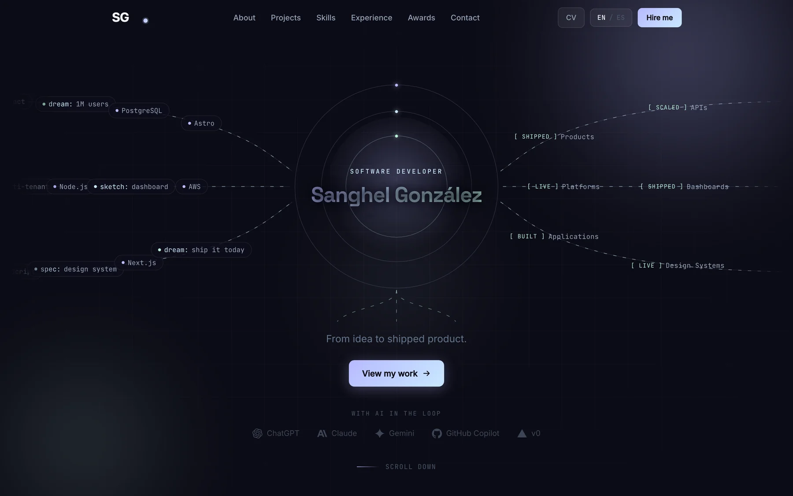

<!-- markdownlint-disable-next-line MD041 -->
<a id="top"></a>

<div align="center">



<h1>Sanghel González — Portfolio</h1>

<p><strong>Software Developer — from idea to shipped product. Fast, bilingual and animated, built with Astro.</strong></p>

<p>
<a href="https://sanghel-portfolio.vercel.app"></a>


</p>

<p>
<a href="https://sanghel-portfolio.vercel.app"><strong>Live site</strong></a> &bull;
<a href="https://sanghel-portfolio.vercel.app/es/"><strong>Versión en español</strong></a> &bull;
<a href="https://www.linkedin.com/in/sanghelgonzalez"><strong>LinkedIn</strong></a> &bull;
<a href="public/sanghel_cv.pdf"><strong>CV</strong></a>
</p>

<br/>

<p>
A single page that tells who I am, what I've built and how to reach me — with a
<strong>Dev Engine</strong> diagram under the hero that turns technologies, ideas and dreams into shipped products.
</p>

<br/>



<br/><br/>

<sub><strong>BUILT WITH</strong></sub>

<br/>


<br/><br/>

</div>

<div align="center"></div>

## Features

<table>
<tr>
<td width="50%" valign="top">

### 🌐 Bilingual
English and Spanish through Astro's i18n routing (`/` and `/es/`), with a language toggle and JSON
dictionaries.

</td>
<td width="50%" valign="top">

### ⚙️ Dev Engine
An animated diagram below the hero: inputs stream in, get processed by the core and leave as shipped
products, platforms and APIs — decorative, with an accessible text description.

</td>
</tr>
<tr>
<td valign="top">

### 🧩 Seven sections
Hero, About, Projects, Skills, Experience, Achievements and Contact, all driven by a typed content layer.

</td>
<td valign="top">

### ✨ Motion
Scroll animations with GSAP and Framer Motion.

</td>
</tr>
<tr>
<td valign="top">

### 🖼️ Optimized images
WebP screenshots through Astro's image pipeline.

</td>
<td valign="top">

### 🚀 Zero-config deploys
Static build on Vercel, deployed on every push.

</td>
</tr>
</table>

<div align="center"></div>

## Tech stack

| Category | Tools |
|---|---|
| Framework |   |
| Styling |  |
| Animation |   |
| Language |  |
| Hosting |  |

<div align="center"></div>

## Quick start

> **Prerequisites:** Node.js `>=22.12.0`

```bash
git clone https://github.com/Sanghel/sanghel-portfolio.git
cd sanghel-portfolio
npm install
npm run dev      # http://localhost:4321
```

| Command | Description |
|---|---|
| `npm run dev` | Development server |
| `npm run build` | Production build → `dist/` |
| `npm run preview` | Preview the production build |

<details>
<summary><strong>Project structure</strong></summary>

```
src/
├── components/
│   ├── layout/     # Navbar, Footer
│   ├── sections/   # Hero, About, Projects, Skills, Timeline, Achievements, Contact
│   └── ui/         # LangToggle
├── content/        # projects.ts (projects, skills, experience, achievements) · engine.ts (Dev Engine data)
├── i18n/           # en.json, es.json + translation utility
├── layouts/        # Base layout
├── pages/          # index.astro (en), es/index.astro
├── styles/         # Design tokens (Tailwind @theme)
└── assets/         # Project screenshots (WebP)
```

</details>

<div align="center"></div>

<div align="center">

<sub>Crafted by <a href="https://github.com/Sanghel"><strong>Sanghel González</strong></a> · <a href="https://www.linkedin.com/in/sanghelgonzalez">LinkedIn</a></sub>

<br/>

<a href="#top">↑ Back to top</a>

</div>
